# AVTrack v0.0.201 — desktop screenshot gallery

Actual screenshots from AVTrack, populated with **fictional broadcast equipment and stock**. No real workspace records were used. Click any image to open it at full resolution. This preview branch contains screenshots only; the application remains on `main` at v0.0.201.

[Open the sample PDF](dense-devices.pdf)

## 1. Cleaner homepage

The two-line headline, summary cards, simplified navigation, Backups icon, and version-only footer. Workspace tables appear inside their workspaces.

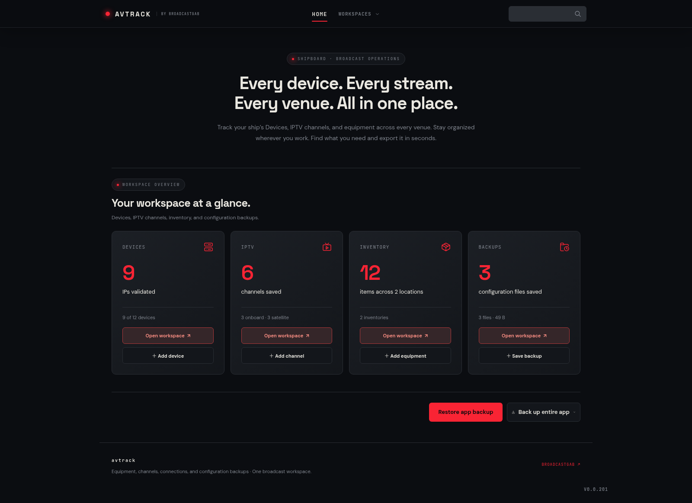

## 2. Workspaces menu

Devices, IPTV, Inventory, and Backups are grouped under Workspaces. Home and global search remain in the top navigation.

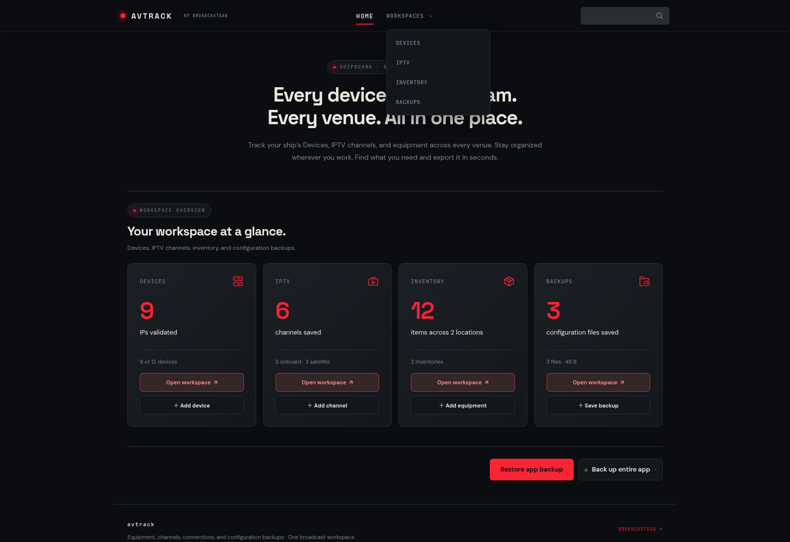

## 3. Compact Devices workspace

Narrower rows, less cell padding, wider use of the desktop, single-line venue labels, and IP validation progress.

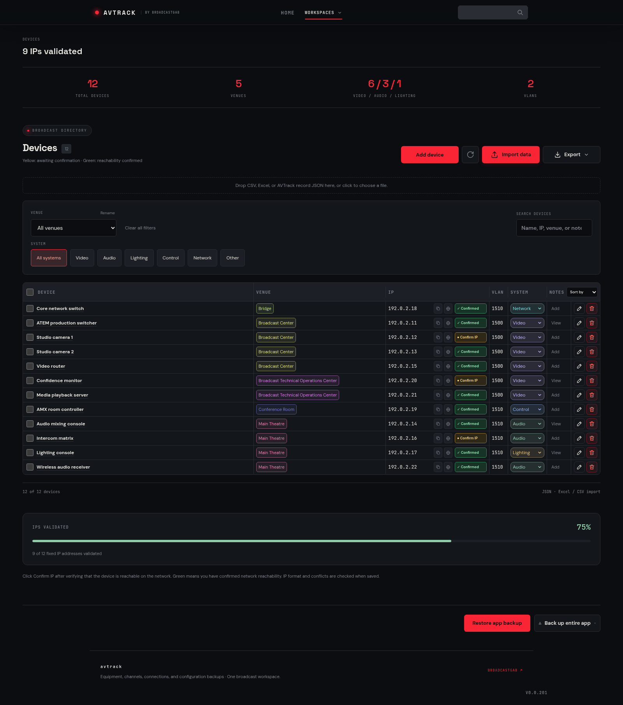

## 4. IP controls close-up

Copy and browser icons sit immediately left of Confirm IP with matching vertical alignment.

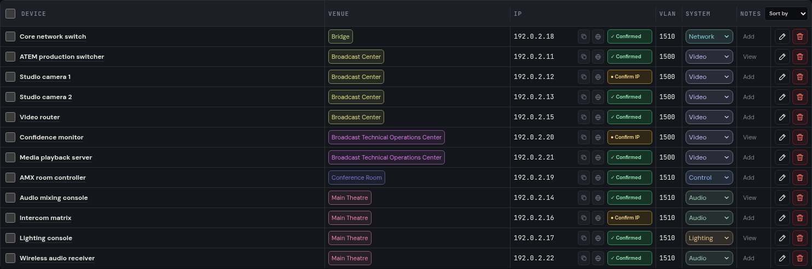

## 5. Rename a venue

Choose a venue and enter a shorter name. The dialog states how many devices will be updated. This screenshot shows a proposed rename that was not saved.

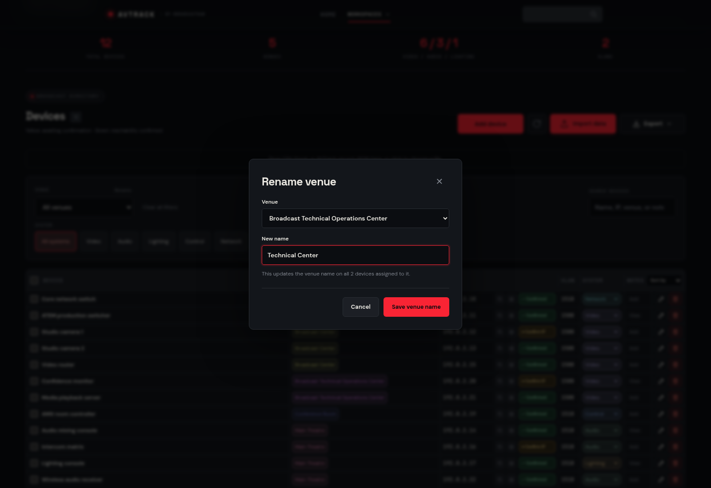

## 6. Compact inventory and automatic Last checked

Status and Last checked remain. The separate Stock check column is removed. Last checked updates when Located is confirmed or missing required fields are completed.

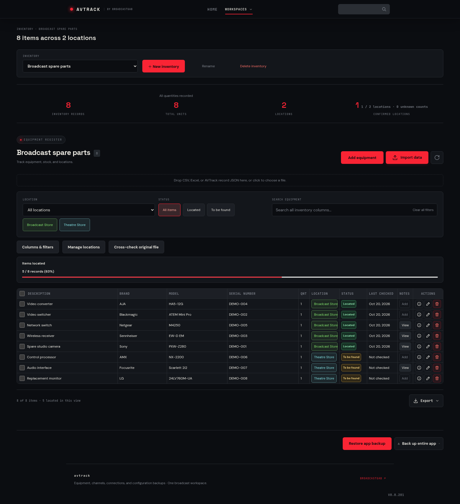

## 7. IPTV workspace with blank Notes

The channel records shown here have blank Notes.

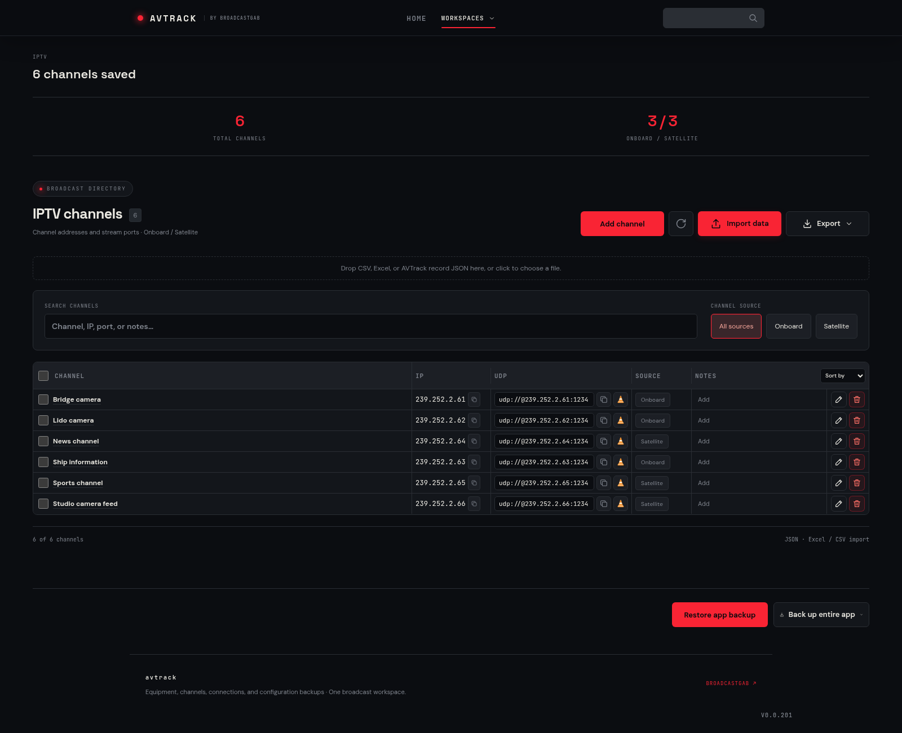

## 8. IPTV import

Choose Channel Name, Multicast IP, and Port. Extra columns do not require names, and imported Notes are left blank. The current preview uses its generic “Needs review” placeholder for empty Notes cells; this does not populate the saved Notes.

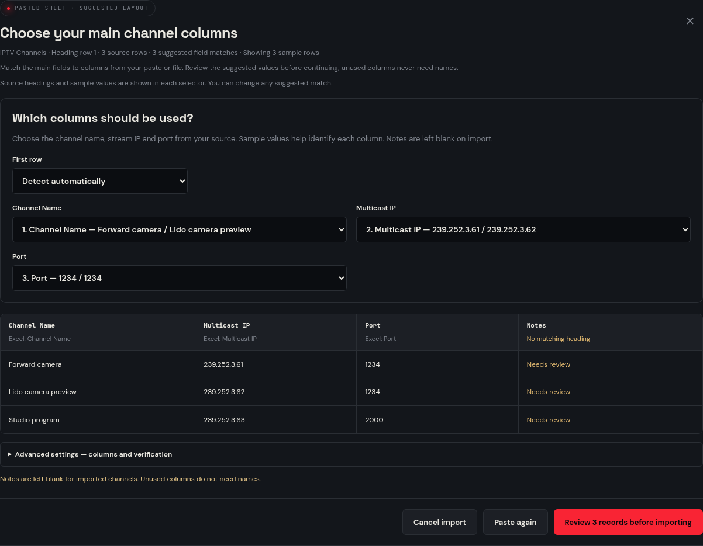

## 9. Search across workspaces

Each matching asset has an **Open in workspace** link alongside its details button.

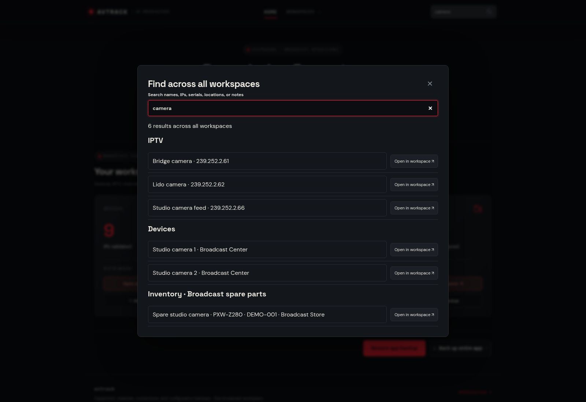

## 10. Open the exact asset

The link opens its workspace, reveals the record, and highlights the matching row. The URL also works after reload.

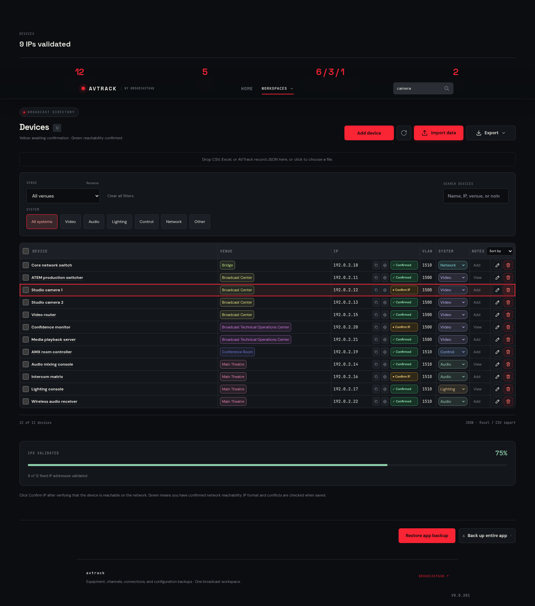

## 11. Denser PDF export

Landscape A4, content-based column widths, tighter padding, and inline device categories. All 35 fictional records in this sample fit on one page.

[View or download the original PDF](dense-devices.pdf)

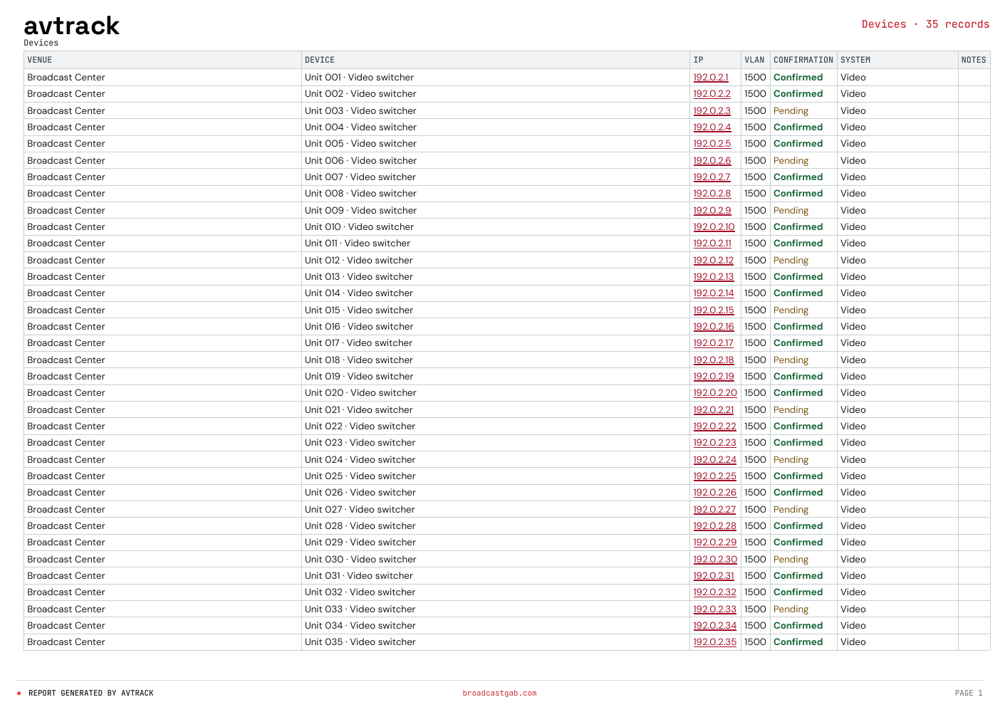

## 12. TV inventory

Content-based widths keep model names, stock counts, Last checked, Notes, and actions together.

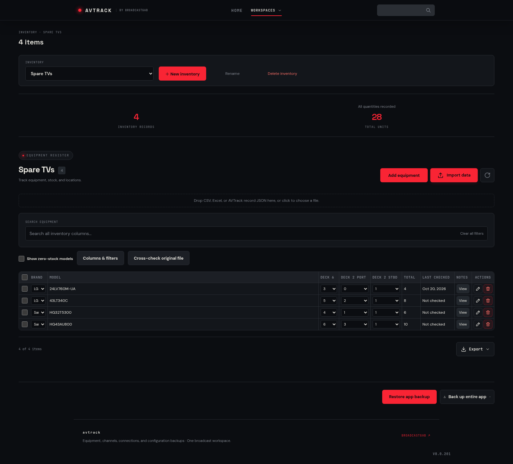
